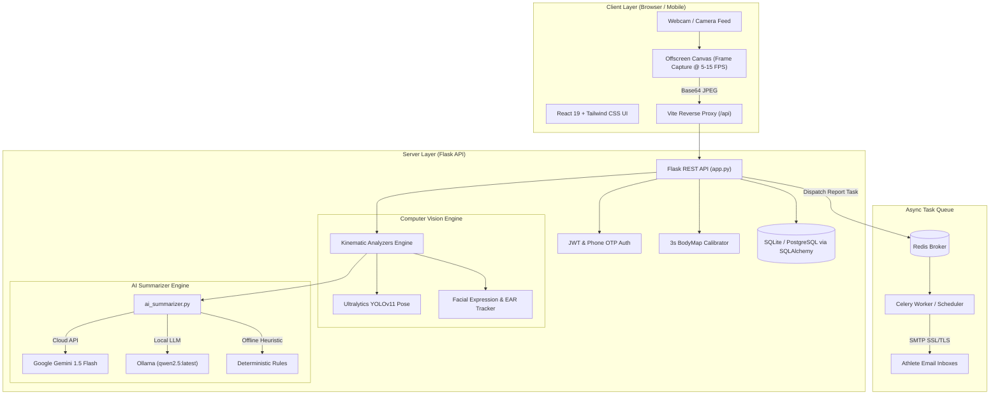

# 🏋️‍♂️ PostureTrek (PoseCare AI)
### *Next-Generation Real-Time Biomechanics, Ergonomics & Motion Intelligence Co-Pilot*

[](https://react.dev/)
[](https://vitejs.dev/)
[](https://www.python.org/)
[](https://flask.palletsprojects.com/)
[](https://docs.ultralytics.com/)
[](https://opencv.org/)
[](https://tailwindcss.com/)
[](https://docs.celeryq.dev/)
[](https://redis.io/)
[](https://ai.google.dev/)

---

## 📖 Table of Contents
1. [Overview](#-overview)
2. [Key Highlights & Capabilities](#-key-highlights--capabilities)
3. [Supported Movement & Analysis Modes](#-supported-movement--analysis-modes)
4. [System Architecture](#-system-architecture)
5. [Modular Project Structure](#-modular-project-structure)
6. [Prerequisites](#-prerequisites)
7. [Step-by-Step Setup Guide](#-step-by-step-setup-guide)
   - [Backend Installation](#1-backend-setup-flask-api)
   - [Frontend Installation](#2-frontend-setup-react--vite)
   - [Background Workers & Scheduled Tasks (Optional)](#3-celery--redis-background-workers-optional)
   - [AI Engine Configuration (Gemini vs. Ollama)](#4-ai-engine-configuration-gemini-or-ollama)
8. [Environment Variables Reference](#-environment-variables-reference)
9. [Demo Accounts & Quick Testing](#-demo-accounts--quick-testing)
10. [Local Network & Mobile Device Access (Wi-Fi)](#-local-network--mobile-device-access-wi-fi)
11. [REST API Reference](#-rest-api-reference)
12. [Troubleshooting & FAQ](#-troubleshooting--faq)

---

## 🌟 Overview

**PostureTrek** (formerly *PoseCare AI*) is an intelligent, camera-driven movement coach and ergonomics guardian. Built to transform any webcam, smartphone, or laptop camera into an expert clinical and athletic feedback station, PostureTrek provides:

- **Sub-millisecond joint kinematic tracking** using Ultralytics YOLOv11 Pose.
- **Dynamic 3D-scaled BodyMap calibration** for individualized anatomies.
- **Real-time multimodal AI coaching** powered by Google Gemini and local Ollama (`qwen2.5`) LLMs.
- **Micro-expression and fatigue telemetry** to alert remote workers and students to cognitive exhaustion.
- **Comprehensive session performance tracking, gamified leaderboards, and automated email reports**.

---

## ⚡ Key Highlights & Capabilities

### 1. Computer Vision & Biomechanics Engine
* **Instant Landmark Inference:** Tracks 17 key body joints in real time (shoulders, elbows, wrists, hips, knees, ankles, eyes, ears) with sub-pixel precision.
* **3-Second BodyMap Calibrator:** Automatically learns the user's limb lengths, standing height, and shoulder width to deliver distortion-free angle calculations regardless of distance from the camera.
* **Biomechanical Form Guard:** Flags common kinematic issues like knee valgus collapse, shallow squat depth, hip sagging during planks, elbow flaring in push-ups, and forward head tilt ("text neck").

### 2. Dual AI Summarizer Co-Pilot
* **Live Micro-Insights:** Non-blocking async worker evaluates form shifts every 2.5 seconds to suggest corrections without stalling video streams.
* **Post-Session Deep Dive:** Structured analysis delivering overall accuracy scores, rep breakdowns, joint-by-joint error logs, targeted recovery advice, and personalized encouragement.
* **Flexible LLM Backend:** Seamlessly switches between cloud **Google Gemini 1.5 Flash** and 100% offline **Ollama** (`qwen2.5:latest`), backed by deterministic rule-based heuristics.

### 3. Ergonomics, Posture & Emotion Telemetry
* **Study & Interview Guard:** Continuous desk ergonomics monitoring to combat spinal strain during prolonged study, coding, or remote interviews.
* **Facial Reaction & Drowsiness Tracker:** Analyzes 468 facial mesh landmarks, blink rates (Eye Aspect Ratio), head tilts, and emotional valence to detect fatigue and stress.

### 4. Enterprise Architecture & Gamification
* **Gamified Progression:** Global leaderboard, dynamic streak tracking, performance badges, and accuracy tiers.
* **Asynchronous Email Delivery:** Celery + Redis pipeline delivers responsive HTML digests (daily/monthly summaries) with zero latency impact on API requests.
* **Secure Mobile/LAN Streaming:** Engineered for multi-device environments—run on your laptop while exercising in front of your smartphone or tablet on the same Wi-Fi network.

---

## 🥋 Supported Movement & Analysis Modes

| Category | Exercise / Mode | Focus & Key Biometrics Analyzed |
| :--- | :--- | :--- |
| **Desk Ergonomics** | **Study & Interview Guard** | Cervical neck flexion angle, slouching detection, screen distance, shoulder leveling |
| **Reaction & Emotion** | **Analyse Reaction & Emotion** | 468-point facial mesh, blink frequency (EAR), fatigue warning, facial tension vs. smile |
| **Gym & Strength** | **Squat** | Knee flexion depth, knee valgus (inward caving), hip hinge, vertical torso angle |
| **Gym & Strength** | **Push-up** | Full plank rigidity, chest-to-ground depth, 45° elbow flare angle |
| **Gym & Strength** | **Lunges** | Front knee 90° angle, knee-past-toe tracker, vertical torso balance |
| **Core & Stability** | **Plank** | Hip drop / hip pike detection, shoulder depression, hold duration clock |
| **Yoga Flow** | **Surya Namaskar** | 12 sacred sun salutation asanas, kinetic flow transitions, forward fold & backbend form |
| **Yoga Asanas** | **Tree Pose (Vrikshasana)** | Single-leg balance stability, pelvic horizontal tilt, vertical spine alignment |
| **Yoga Asanas** | **Tadasana / Warrior II / Cobra** | Joint alignment, grounding symmetry, shoulder expansion, lumbar curve protection |

---

## 🏗️ System Architecture



---

## 📁 Modular Project Structure

```
AI SUMMIT SHOWCASE/
├── README.md                      # Master Project Documentation & Quickstart
├── yolo11n-pose.pt                # YOLOv11 Nano Pose Model weights
│
├── backend/                       # Python Flask API & CV Microservice
│   ├── app.py                     # Application entry point, CORS, extensions & router
│   ├── models.py                  # SQLAlchemy schemas (User, Session, RepLog)
│   ├── seed.py                    # Database auto-seeder with 5 demo athletes & 30-day history
│   ├── ai_summarizer.py           # Gemini & Ollama multimodal LLM evaluation engine
│   ├── celery_app.py              # Celery tasks & responsive HTML email templating
│   ├── requirements.txt           # Python backend dependencies
│   ├── .env                       # Environment configuration (API keys, SMTP, Redis)
│   │
│   ├── routes/                    # Modular API Blueprints
│   │   ├── auth.py                # Phone OTP registration & login (JWT issuance)
│   │   ├── movement.py            # Live frame processing, calibration & session logging
│   │   ├── dashboard.py           # User stats, weekly aggregates & streaks
│   │   ├── sessions.py            # Historical session lookups & detailed rep telemetry
│   │   ├── reports.py             # Email report dispatch & frequency preferences
│   │   └── profile.py             # Athlete biometric profile & goal updates
│   │
│   ├── analyzers/                 # Biomechanical Kinematic Analyzers (Physical Movements)
│   │   ├── bodymap.py             # 3-Second BodyMap calibration HUD & anatomical scaling
│   │   ├── desk_posture_analyzer.py # Study, interview, text-neck & ergonomics monitor
│   │   ├── squat_analyzer.py      # Hip hinge, knee flexion & valgus analysis
│   │   ├── pushup_analyzer.py     # Chest depth, elbow angle & plank rigidity
│   │   ├── lunge_analyzer.py      # Knee-over-toe & unilateral leg stability
│   │   ├── plank_analyzer.py      # Core anti-extension & hip displacement hold timer
│   │   ├── surya_namaskar_analyzer.py # 12-pose Sun Salutation sequence recognition
│   │   └── yoga_pose_analyzer.py  # Tree pose, Warrior II, Tadasana, Cobra, Downward Dog
│   │
│   ├── reaction/                  # Dedicated Facial Reaction, Mood & Fatigue Engine
│   │   ├── reaction_analyzer.py   # Reaction telemetry, mood, engagement & tension analyzer
│   │   └── expression_analyzer.py # 468-mesh facial fatigue, emotion & drowsiness tracker
│   │
│   └── instance/                  # SQLite runtime data
│       └── postretrek.sqlite
│
├── frontend/                      # React 19 + Vite Frontend SPA
│   ├── package.json               # Frontend dependencies & npm scripts
│   ├── vite.config.js             # Vite dev server with 0.0.0.0 host & /api reverse proxy
│   ├── index.html                 # HTML shell
│   │
│   └── src/
│       ├── main.jsx               # Application root
│       ├── Router.jsx             # React Router v7 routing definitions
│       ├── index.css              # Tailwind CSS v4 styling & animations
│       │
│       ├── pages/                 # Primary Application Views
│       │   ├── Dashboard.jsx      # Activity overview, streak counters & weekly charts
│       │   ├── PoseAnalysis.jsx   # Real-time camera HUD, exercise selector & AI coach
│       │   ├── Exercises.jsx      # Curated movement library with instructions & video guides
│       │   ├── Sessions.jsx       # Historical workout logs with rep breakdown modals
│       │   ├── Progress.jsx       # Long-term fitness & posture trajectory charts
│       │   ├── Leaderboard.jsx    # Competitive community rankings & top 3 podium
│       │   ├── Profile.jsx        # User biometric stats, goals & email report settings
│       │   ├── Login.jsx          # Mobile OTP login & modern registration flow
│       │   └── Home.jsx           # Landing & feature showcase
│       │
│       ├── components/            # Reusable UI Components
│       │   └── Navbar.jsx         # Responsive glassmorphism navigation header
│       ├── context/               # Global React State (AuthContext, etc.)
│       └── api/                   # Axios API client & interceptors
│
├── docs/                          # Additional event documentation
└── model/                         # Auxiliary training & validation scripts
```

---

## 💻 Prerequisites

Before running PostureTrek, ensure you have the following installed on your host system:

* **Node.js**: `v18.0.0` or higher (tested on Node 20 / 22) & `npm`
* **Python**: `v3.10` or higher (tested on Python 3.10 / 3.11 / 3.12)
* **Webcam**: Built-in laptop camera, USB webcam, or smartphone camera stream
* **Redis** *(Optional)*: Required only if you want to run the background Celery email reporting queue

---

## 🚀 Step-by-Step Setup Guide

### 1. Backend Setup (Flask API)

1. Open your terminal and navigate to the backend directory:
   ```bash
   cd backend
   ```

2. Create and activate a Python virtual environment:
   ```bash
   # macOS / Linux:
   python3 -m venv env
   source env/bin/activate

   # Windows:
   python -m venv env
   env\Scripts\activate
   ```

3. Install all required Python packages:
   ```bash
   pip install --upgrade pip
   pip install -r requirements.txt
   ```

4. Configure your environment variables:
   A sample `.env` file is included in `backend/.env`. Check or update it as needed:
   ```bash
   cp .env.example .env   # Or edit backend/.env directly
   ```

5. Run the Flask server:
   ```bash
   python app.py
   ```
   > **Note:** On the very first run, `app.py` will automatically initialize SQLite tables and seed 5 demo athlete accounts with 30 days of workout history!

   The backend will start and log:
   ```text
   =======================================================
    🚀 PostureTrek Backend Server
   =======================================================
    Local:   http://127.0.0.1:5000
    Network: http://<your-local-ip>:5000 (accessible on local WiFi)
    Binding: http://0.0.0.0:5000
   =======================================================
   ```

---

### 2. Frontend Setup (React + Vite)

1. Open a second terminal window and navigate to the frontend directory:
   ```bash
   cd frontend
   ```

2. Install the frontend dependencies:
   ```bash
   npm install
   ```

3. Start the Vite development server:
   ```bash
   npm run dev
   ```

4. Open your browser and navigate to:
   - **Local Machine:** [http://localhost:5173](http://localhost:5173)
   - **Local Network / Phone:** `http://<your-local-ip>:5173`

---

### 3. Celery & Redis Background Workers (Optional)

If you want to test automated daily/monthly email report delivery via Redis and Celery:

1. **Start Redis Server:**
   ```bash
   redis-server
   ```

2. **Start the Celery Task Worker:**
   ```bash
   cd backend
   source env/bin/activate
   celery -A celery_app.celery_app worker --loglevel=info
   ```

3. **Start the Celery Beat Scheduler (for periodic daily/monthly digests):**
   ```bash
   cd backend
   source env/bin/activate
   celery -A celery_app.celery_app beat --loglevel=info
   ```
   *(If Redis is not running, PostureTrek automatically falls back gracefully to direct dispatch without crashing).*

---

### 4. AI Engine Configuration (Gemini or Ollama)

PostureTrek features an intelligent fallback chain for AI summaries:
```
1. Ollama (Local LLM)  -->  2. Google Gemini 1.5 Flash (Cloud)  -->  3. Deterministic Biomechanical Rules
```

#### Option A: Cloud Google Gemini (Recommended for cloud accuracy)
Add your Gemini API key in `backend/.env`:
```env
GEMINI_API_KEY=AIzaSy...your_gemini_api_key_here
```
Get a free key from the [Google AI Studio](https://aistudio.google.com/).

#### Option B: Local Ollama (Recommended for offline, zero-latency inference)
1. Install [Ollama](https://ollama.com/).
2. Pull the model:
   ```bash
   ollama pull qwen2.5:latest
   ```
3. Start the Ollama server:
   ```bash
   ollama serve
   ```
4. In `backend/.env`, confirm:
   ```env
   OLLAMA_URL=http://localhost:11434/api/generate
   OLLAMA_MODEL=qwen2.5:latest
   ```

---

## ⚙️ Environment Variables Reference

Configure these in `backend/.env`:

| Variable | Default Value | Description |
| :--- | :--- | :--- |
| `FLASK_HOST` | `0.0.0.0` | Host interface to bind the Flask server to |
| `FLASK_PORT` | `5000` | Port for the backend API |
| `FLASK_DEBUG` | `True` | Flask debug reload flag |
| `SECRET_KEY` | `dev-secret-change-me` | Secret key for session security |
| `JWT_SECRET_KEY` | `dev-jwt-secret-change-me`| Secret key used to sign JWT tokens |
| `GEMINI_API_KEY` | *(Optional)* | Google Gemini API Key for AI coaching |
| `OLLAMA_URL` | `http://localhost:11434/api/generate` | Local Ollama endpoint |
| `OLLAMA_MODEL` | `qwen2.5:latest` | Ollama model name |
| `REDIS_URL` | `redis://localhost:6379/0` | Redis broker URL for Celery |
| `SMTP_SERVER` | `smtp.gmail.com` | SMTP server host for email reports |
| `SMTP_PORT` | `587` | SMTP port (STARTTLS: 587, SSL: 465) |
| `SENDER_EMAIL` | `admin.auratrek@gmail.com` | Notification sender email |
| `SENDER_PASSWORD` | *(App Password)* | 16-character Google App Password |

---

## 👥 Demo Accounts & Quick Testing

The database automatically seeds 5 realistic athlete profiles with pre-populated session histories. You can log into any of these accounts immediately:

| Athlete Name | Mobile Number | Password / OTP | Default Focus |
| :--- | :--- | :--- | :--- |
| **Arjun Mehta** | `9876543210` | **`123456`** | Strength & Squats |
| **Priya Kapoor** | `9876543211` | **`123456`** | Yoga & Surya Namaskar |
| **Dev Sharma** | `9876543212` | **`123456`** | Calisthenics & Push-ups |
| **Neha Singh** | `9876543213` | **`123456`** | Core & Planks |
| **Rohan Verma** | `9876543214` | **`123456`** | Desk Posture & Ergonomics |

> 💡 **Self-Registration:** You can also click **"Sign Up"** in the app to register your own account with your phone number, email, and fitness goals. In development mode, the verification OTP is always **`123456`**.

---

## 🌐 Local Network & Mobile Device Access (Wi-Fi)

PostureTrek supports full remote execution across multiple devices connected to the same Wi-Fi network (e.g., placing your smartphone on the floor to track your squats while the server runs on your laptop).

### Step 1: Discover Your Machine's Local IP
On macOS:
```bash
ipconfig getifaddr en0
```
On Linux:
```bash
hostname -I | awk '{print $1}'
```
On Windows:
```cmd
ipconfig
```
*(Example: `192.168.1.15`)*

### Step 2: Connect from Any Smartphone, Tablet, or PC
Open the browser on your mobile device and navigate to:
```text
http://192.168.1.15:5173
```

### Step 3: Enabling Camera Access on Mobile Browsers (HTTP LAN Flag)
Modern mobile browsers (iOS Safari, Android Chrome) block camera access (`getUserMedia`) on plain HTTP connections outside `localhost`. If testing on an Android device over HTTP Wi-Fi:
1. Open **Google Chrome** on your mobile device.
2. In the URL bar, go to: `chrome://flags/#unsafely-treat-insecure-origin-as-secure`
3. Enter your local URL: `http://192.168.1.15:5173`
4. Set the flag dropdown to **Enabled** and tap **Relaunch**.
5. Camera permissions will now function smoothly over your local Wi-Fi!

---

## 📡 REST API Reference

### 🔐 Authentication (`/api`)
- `POST /api/register` – Register a new athlete (`name`, `email`, `phone`, `gender`).
- `POST /api/login` – Request or verify 6-digit phone OTP. Returns JWT Bearer token.
- `GET /api/me` – Retrieve the authenticated athlete's session context.

### 🏃 Real-Time Pose & Motion Analysis (`/api/pose`)
- `POST /api/pose/calibrate_start` – Initiates 3-second anatomical calibration.
- `POST /api/pose/calibrate_frame` – Streams calibration frames with HUD overlay.
- `POST /api/pose/start` – Begins workout session (`exercise_type`, `user_id`).
- `POST /api/pose/analyze_frame` – Ingests base64 image frame, executes YOLOv11 inference, calculates joint angles, and returns live HUD metrics.
- `POST /api/pose/live_ai_summary` – Polls async micro-coaching insights.
- `POST /api/pose/stop` – Concludes session, aggregates rep logs, triggers LLM summary generation, and persists stats to the database.

### 📊 Dashboard & Leaderboard
- `GET /api/dashboard/summary` – Aggregated stats (total sessions, reps, streak, accuracy).
- `GET /api/dashboard/recent_sessions` – Retrieves the 5 most recent sessions.
- `GET /api/dashboard/weekly` – Daily rep distribution over the past 7 days.
- `GET /api/leaderboard` – Global community rankings, badges, and top-tier podium.

### 📑 Reports & Profile
- `POST /api/reports/send` – Dispatches an instant HTML workout digest via Celery/SMTP.
- `GET /api/profile` / `PUT /api/profile` – Fetches or updates physical stats (height, weight, fitness goals).

---

## 🛠️ Troubleshooting & FAQ

#### Q: "Camera not starting / Permission denied"
- Make sure you are accessing via `http://localhost:5173` on your PC, or follow the [Chrome Flags guide](#step-3-enabling-camera-access-on-mobile-browsers-http-lan-flag) if accessing via mobile Wi-Fi.
- Check that another app (Zoom, Teams, FaceTime) is not currently locking the webcam.

#### Q: "YOLO model download error"
- On first launch, `ultralytics` will verify `yolo11n-pose.pt`. A pre-downloaded copy is included in the workspace root and backend folder. If an internet timeout occurs, ensure `yolo11n-pose.pt` is located in `backend/`.

#### Q: "Celery worker says connection refused to redis://localhost:6379/0"
- Redis is optional. If you don't need automated email digests, you can disregard this error; all workout logging, posture analysis, and dashboard features work independently of Redis.

#### Q: "How do I test with my own webcam in real time?"
1. Start backend: `cd backend && python app.py`
2. Start frontend: `cd frontend && npm run dev`
3. Go to `http://localhost:5173`, log in with `9876543210` (OTP: `123456`).
4. Click **"Pose Analysis"** in the navigation bar.
5. Select any exercise (e.g. **Squat** or **Study & Interview Guard**) and click **"Start AI Analysis"**.

---

<p align="center">
  <b>PostureTrek</b> • Built with ❤️ for AI Summit Showcase • Empowering healthier movement through computer vision.
</p>
