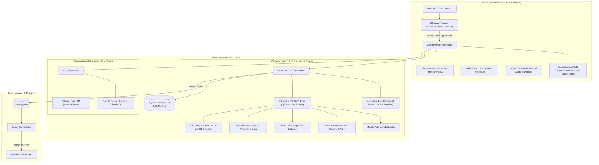

# 🏋️‍♂️ PostureTrek (PoseCare AI)
### *Next-Generation Real-Time Biomechanics, Ergonomics & Motion Intelligence Co-Pilot*

[](https://react.dev/)
[](https://vitejs.dev/)
[](https://www.python.org/)
[](https://flask.palletsprojects.com/)
[](https://docs.ultralytics.com/)
[](https://developer.apple.com/metal/)
[](https://threejs.org/)
[](https://tailwindcss.com/)
[](https://docs.celeryq.dev/)
[](https://redis.io/)
[](https://ai.google.dev/)

---

## 📖 Table of Contents
1. [Overview](#-overview)
2. [Key Highlights & Advanced Capabilities](#-key-highlights--advanced-capabilities)
3. [Master Feature, Tech Stack & Architecture Matrix](#-master-feature-tech-stack--architecture-matrix)
4. [Supported Movement & Analysis Modes](#-supported-movement--analysis-modes)
5. [Deep Dive: Under the Hood Engineering & Biomechanical Mathematics](#-deep-dive-under-the-hood-engineering--biomechanical-mathematics)
   - [5.1 Vision-Based Breath Detection (Pranayama-Kinematics Sync)](#51-vision-based-breath-detection-pranayama-kinematics-sync)
   - [5.2 Biomechanical Joint-Load & Torque Modeling (Inverse Dynamics)](#52-biomechanical-joint-load--torque-modeling-inverse-dynamics)
   - [5.3 Personalized Anatomical Calibration (Proportion Invariance)](#53-personalized-anatomical-calibration-proportion-invariance)
   - [5.4 Smart Camera Autopilot & Perspective Yaw Correction](#54-smart-camera-autopilot--perspective-yaw-correction)
   - [5.5 Kinematic Muscle Activation Estimation & Mind-Muscle Connection](#55-kinematic-muscle-activation-estimation--mind-muscle-connection)
   - [5.6 Interactive 3D Kinematic Trainer Bot (Three.js WebGL)](#56-interactive-3d-kinematic-trainer-bot-threejs-webgl)
   - [5.7 "Ask AI" Conversational Lifestyle Coach & Ergonomics Advisor](#57-ask-ai-conversational-lifestyle-coach--ergonomics-advisor)
   - [5.8 Facial Expression, Emotion & Drowsiness Mesh Telemetry](#58-facial-expression-emotion--drowsiness-mesh-telemetry)
   - [5.9 Hardware Acceleration & Low-Latency Video Pipeline (Apple MPS GPU)](#59-hardware-acceleration--low-latency-video-pipeline-apple-mps-gpu)
6. [System Architecture Diagram](#-system-architecture-diagram)
7. [Modular Project Structure](#-modular-project-structure)
8. [Prerequisites & System Requirements](#-prerequisites--system-requirements)
9. [Step-by-Step Setup Guide](#-step-by-step-setup-guide)
10. [REST API Reference](#-rest-api-reference)
11. [Troubleshooting & FAQ](#-troubleshooting--faq)
12. [Technical Documentation PDF](#-technical-documentation-pdf)

---

## 🌟 Overview

**PostureTrek** (PoseCare AI) is a next-generation biomechanical co-pilot, computer vision rehabilitation station, and conversational health coach. Transforming any webcam, smartphone, or laptop camera into a clinical-grade motion capture and movement analysis lab, PostureTrek solves the fundamental flaw of legacy fitness apps: **treating every human body as an identical rigid template**.

By pairing sub-millisecond **YOLOv11 Pose** keypoint tracking with **inverse dynamics joint torque modeling**, **morphological proportion calibration**, **vision-based respiratory sync**, and **multimodal conversational AI (Ollama `qwen2.5` & Google Gemini)**, PostureTrek provides:

- **True Individualized Calibration**: Measures femur-to-torso ratios and scales lean tolerances so long-femur lifters aren't penalised for biomechanically required forward leans.
- **Injury Prevention Before Pain**: Computes real-time bending moments ($N \cdot m$) and shear forces ($N$) on vulnerable joints like the **L5-S1 lumbar disc** and **patellofemoral knee joint**.
- **Pranayama-Kinematics Synchronization**: Estimates real-time respiratory phases (`INHALE`, `EXHALE`, `HOLD`) and respiratory rate (BPM) from thoracic micro-displacements to ensure asanas align with respiration.
- **Interactive 3D Kinematic Trainer Bot**: Real-time Three.js digital twin showing dynamic limb alignments, muscle recruitment bars, and mind-muscle coaching cues.
- **"Ask AI" Lifestyle & Ergonomics Advisor**: Natural speech-to-text voice recognition and audio playback delivering custom routines, desk habit corrections, and beyond-the-app lifestyle prescriptions.

---

## ⚡ Key Highlights & Advanced Capabilities

### 1. Clinical Biomechanics & Computer Vision
* **Ultralytics YOLOv11 Pose on Apple MPS GPU:** Sub-pixel landmark tracking across 17 skeletal joints accelerated via Metal Performance Shaders for ultra-low latency (<25ms inference).
* **Inverse Dynamics Joint Torque Modeling:** Estimates Newtonian shear forces and gravitational torques on the L5-S1 lumbar spine and knees using anthropometric mass segment tables.
* **Proportion Invariance Calibration:** 3-second anatomical calibration routine calculates skeletal segment ratios (femur/torso, tibia/femur) and bone-stop thresholds.
* **Smart Camera Autopilot:** Detects body clipping against screen edges, evaluates camera distance, and measures 3D yaw perspective foreshortening with live audio/visual guidance.
* **Kinematic Muscle Activation:** Dynamically estimates muscle recruitment percentages (0–100%) for Quadriceps, Gluteus Maximus, Hamstrings, Core, Erector Spinae, Pectoralis, and Deltoids.

### 2. Conversational Health Coach ("Ask Me" AI)
* **Voice-First Interaction:** Hands-free speech recognition (Web Speech API) supporting bilingual Hindi/English speech-to-text, paired with concise audio playback via Speech Synthesis.
* **Zero Presumption & Zero Fake Fallbacks:** Curates advice strictly from the user's voice query. Backed by local Ollama `qwen2.5` LLM; honest error handling if offline.
* **Beyond-the-App Daily Prescriptions:** Prescribes crucial non-screen habits including the **20-20-20 Screen Rule (Look Away)**, **5-Minute Hourly Micro-Walks**, **20-Minute Outdoor Running & Cardio**, and **Desk Shoulder Rolls**.
* **1-Click Workout Launcher:** All prescribed exercises link directly to live camera tracking with a single tap.

### 3. Emotion, Facial Tension & Drowsiness Mesh
* **468-Point Facial Landmark Mesh:** Real-time Eye Aspect Ratio (EAR) blink frequency, head yaw/pitch, and mouth stress analysis to flag cognitive exhaustion during desk work.

---

## 📊 Master Feature, Tech Stack & Architecture Matrix

| Feature | Category | Frontend Stack | Backend & CV Stack | Architectural Mechanism (Under the Hood) | Key Files |
| :--- | :--- | :--- | :--- | :--- | :--- |
| **Joint Kinematics Tracking** | Pose Estimation | Canvas API, React 19 | Ultralytics YOLOv11 Pose, PyTorch (`mps`), OpenCV | 17 keypoint heatmap regression + confidence thresholding (0.45) on Metal Performance Shaders | `movement.py`, `yolo11n-pose.pt` |
| **Breath Detection (Pranayama)** | Biomechanics / Respiratory | Dynamic SVG waveform, React 19 | NumPy, SciPy, Rolling Window Moving Average | Thoracic/clavicular vertical micro-displacement tracking relative to mid-hip; peak/trough derivative zero-crossing | `breath_detector.py`, `PoseAnalysis.jsx` |
| **Joint Torque & Load Modeling** | Inverse Dynamics | Dynamic gauge widgets, TailwindCSS v4 | Dempster-Winter mass tables, NumPy inverse dynamics | Upper-body mass moment arm: $\tau = m_{\text{upper}} \cdot g \cdot \Delta x_{\text{trunk}}$; knee reaction moment calculation | `joint_torque_model.py`, `PoseAnalysis.jsx` |
| **Anatomical Calibration** | Anthropometry | Live countdown HUD, SVG reticle | Vector Euclidean geometry, NumPy | Femur/torso and tibia/femur segment ratios; morphology classification (long/short femur) scaling tolerances | `anatomical_calibration.py`, `bodymap.py` |
| **Camera Autopilot** | Computer Vision / Frustum | Floating HUD direction pill | Bounding box border margin analysis, trigonometry | Normalized margin ratios ($y_{\min} < 0.04$, $y_{\max} > 0.96$); bi-acromial perspective foreshortening yaw | `camera_autopilot.py`, `PoseAnalysis.jsx` |
| **Muscle Group Activation** | Neuromuscular Simulation | Live progress bars, mind-muscle badges | Kinematic joint excursion models, transfer functions | Sigmoidal transfer functions mapping joint angles and angular velocity to motor unit recruitment (0–100%) | `muscle_activation.py`, `PoseAnalysis.jsx` |
| **3D AI Kinematic Trainer Bot** | 3D WebGL Visualization | Three.js, Canvas, React 19 | Normalized 3D skeletal telemetry payload | 3D bone rigging with spherical joint interpolation matching live user coordinates in WebGL space | `Pose3DBotViewer.jsx` |
| **"Ask AI" Lifestyle Coach** | Conversational LLM | Web Speech API, SpeechSynthesis, React 19 | Ollama (`qwen2.5:latest`), Google Gemini 1.5 Flash, Flask | Few-shot in-context learning with ground-truth training benchmarks; concise voice line extraction | `ask_ai.py`, `AskMe.jsx` |
| **Desk Ergonomics Guard** | Clinical Ergonomics | Real-time posture score meter | Angle geometry, rolling alert timers | Cervical spine angle ($\theta_{\text{ear-shoulder-hip}}$) vs. ergonomic 15° threshold; slouching detection | `desk_posture_analyzer.py` |
| **Reaction & Emotion Analysis** | Facial Biometrics | Emotion valence gauge, EAR meter | MediaPipe FaceMesh (468 points), OpenCV | Eye Aspect Ratio $\text{EAR} = \frac{\|p_2 - p_6\| + \|p_3 - p_5\|}{2\|p_1 - p_4\|}$; blink rate & fatigue telemetry | `expression_analyzer.py`, `reaction_analyzer.py` |
| **Surya Namaskar 12-Flow** | Yoga Kinematics | Step progression stepper, accuracy % | Finite State Machine (FSM), angle heuristics | 12 sacred pose transition engine; per-step accuracy scoring and skipped step highlighting | `surya_namaskar_analyzer.py` |
| **Async Email Reporting** | Enterprise Reporting | Responsive HTML digest template | Celery, Redis Broker, Python SMTP SSL/TLS | Decoupled background queue formatting workout summaries with SVG charts and automated dispatch | `celery_app.py`, `reports.py` |

---

## 🥋 Supported Movement & Analysis Modes

| Category | Exercise / Mode | Key Biometric Parameters & Guard Rails |
| :--- | :--- | :--- |
| **Desk Ergonomics** | **Study & Interview Guard** | Cervical neck flexion angle, forward head posture ("text neck"), shoulder leveling, screen distance |
| **Reaction & Emotion** | **Reaction & Emotion AI** | 468-point facial mesh, blink frequency (EAR), fatigue warning, facial tension vs. genuine smile |
| **Traditional Yoga Flow**| **Surya Namaskar (12 Asanas)** | Sequence state machine, kinetic chain transitions, Pranayama breath sync scoring, per-step breakdown |
| **Hatha Yoga & Balance**| **Bhujangasana (Cobra Pose)** | Spinal extension curvature, scapular depression, chest expansion, lumbar disc safety |
| **Hatha Yoga & Balance**| **Vrikshasana (Tree Pose)** | Single-leg balance index, lateral pelvic tilt, core bracing, neuromuscular sway stability |
| **Hatha Yoga & Balance**| **Adho Mukha Svanasana (Downward Dog)** | Posterior chain flexibility, shoulder-wrist kinetic line, thoracic spine opening, heel-to-floor proximity |
| **Gym & Strength** | **Bodyweight Squat** | Femur-scaled depth, knee valgus (inward collapse), hip hinge moment, L5-S1 lumbar shear torque |
| **Gym & Strength** | **Push-up** | Full plank rigidity, chest-to-ground depth, 45° elbow flare angle, scapular stabilization |
| **Gym & Strength** | **Walking Lunges** | Front knee 90° angle, knee-past-toe tracker, vertical torso balance, bilateral symmetry |
| **Core Stability** | **Core Plank Hold** | Anti-extension core hold, lumbar lordosis prevention, hold duration timer, glute engagement |

---

## 🧠 Deep Dive: Under the Hood Engineering & Biomechanical Mathematics

### 5.1 Vision-Based Breath Detection (Pranayama-Kinematics Sync)
* **Underlying Tech:** Python, NumPy, SciPy, OpenCV, WebGL.
* **Mechanism Behind the Hood:**
  Yoga and athletic performance require movement to synchronize with respiration. Rather than requiring wearable chest straps, PostureTrek isolates vertical and lateral displacement vectors of the **clavicle (Keypoints 5 & 6)**, **sternum**, and **rib cage** relative to the stable **pelvic midpoint (Keypoints 11 & 12)**:
  $$\Delta y_{\text{chest}}(t) = y_{\text{clavicle}}(t) - y_{\text{pelvis}}(t)$$
  To eliminate camera sensor noise, displacements are smoothed via a 15-frame rolling-window moving average. Respiratory state transitions are determined by the first derivative zero-crossing:
  $$\frac{d}{dt}\left[\Delta y_{\text{chest}}(t)\right] > 0 \implies \text{INHALE}, \quad \frac{d}{dt}\left[\Delta y_{\text{chest}}(t)\right] < 0 \implies \text{EXHALE}$$
  Respiratory rate in **BPM** is computed via peak-to-peak interval detection:
  $$\text{BPM} = \frac{60}{\Delta t_{\text{peak-to-peak}}}$$
  The **Pranayama Sync Score** compares the current exercise transition (e.g. chest expansion vs. forward fold) against the respiratory phase, providing real-time audio/visual prompts.

---

### 5.2 Biomechanical Joint-Load & Torque Modeling (Inverse Dynamics)
* **Underlying Tech:** Dempster-Winter Anthropometric Mass Tables, NumPy, Vector Calculus.
* **Mechanism Behind the Hood:**
  Traditional fitness apps alert users only when an angle looks "wrong." PostureTrek calculates the physical Newtonian forces acting on vulnerable joints using top-down inverse dynamics:
  1. **Segment Masses:** Scaled to the user's calibrated mass ($m$) using Dempster's anthropometric ratios (Head + Trunk $\approx 0.497m$, Upper Limbs $\approx 0.100m$, Thighs $\approx 0.200m$).
  2. **L5-S1 Lumbar Spine Bending Moment:** Computes the horizontal distance (moment arm $\Delta x_{\text{trunk}}$) between the upper body center of mass and the lumbosacral junction:
     $$\tau_{\text{L5-S1}} = m_{\text{upper}} \cdot g \cdot \Delta x_{\text{trunk}} \quad [N \cdot m]$$
  3. **Shear Stress:** Calculates shear reaction forces parallel to the sacral plateau:
     $$F_{\text{shear}} = m_{\text{upper}} \cdot g \cdot \sin(\theta_{\text{trunk}}) \quad [N]$$
  4. **Patellofemoral Knee Joint Torque:** Computes unilateral flexion torque based on femur inclination and knee ground-reaction line.
  *If shear force exceeds $450\,N$ or torque exceeds $190\,N \cdot m$, a clinical overload warning triggers immediately.*

---

### 5.3 Personalized Anatomical Calibration (Proportion Invariance)
* **Underlying Tech:** Euclidean Vector Geometry, Statistical Morphology Indexing.
* **Mechanism Behind the Hood:**
  Standard templates fail because skeletal limb proportions vary drastically across humans:
  - **Femur-to-Torso Ratio:** $\rho_{\text{FT}} = \frac{L_{\text{femur}}}{L_{\text{torso}}}$
  - **Tibia-to-Femur Ratio:** $\rho_{\text{TF}} = \frac{L_{\text{tibia}}}{L_{\text{femur}}}$
  During the 3-second T-pose calibration, PostureTrek measures these ratios:
  - **Long Femur Morphology ($\rho_{\text{FT}} > 0.86$):** To keep the combined center-of-mass over the midfoot, these lifters *must* pitch forward up to $44^\circ$. PostureTrek scales the forward lean tolerance from $30^\circ \to 44^\circ$, eliminating false "excessive forward lean" errors.
  - **Bone-Stop Index:** Differentiates structural bone-on-bone impingements (e.g. deep hip socket morphology) from neuromuscular flexibility deficits, adjusting depth targets accordingly.

---

### 5.4 Smart Camera Autopilot & Perspective Yaw Correction
* **Underlying Tech:** Camera Frustum Ray-Casting, Perspective Foreshortening Trigonometry.
* **Mechanism Behind the Hood:**
  To guarantee sub-pixel accuracy, the camera autopilot continuously evaluates:
  1. **Clipping Ratios:** Flags when body keypoints violate normalized boundaries:
     $$\text{Head Clipping}: y_{\min} < 0.04, \quad \text{Foot Clipping}: y_{\max} > 0.96, \quad \text{Lateral Clipping}: x_{\min} < 0.05 \text{ or } x_{\max} > 0.95$$
  2. **Distance Status:** Calculates the bounding box height ratio against total frame height ($H_{\text{bbox}} / H_{\text{frame}}$). Flags `too_close` ($> 84\%$) or `too_far` ($< 35\%$).
  3. **3D Body Yaw Angle ($\psi$):** Evaluates perspective compression between bi-acromial shoulder width ($W_{\text{shoulder}}$) and bi-iliac hip width ($W_{\text{hip}}$) relative to calibrated baseline:
     $$\psi = \arccos\left(\frac{W_{\text{observed}}}{W_{\text{calibrated}}}\right)$$
  Provides live prompts such as *"2 कदम पीछे हटें"* or *"मैट को 45° घुमाएं"*.

---

### 5.5 Kinematic Muscle Activation Estimation & Mind-Muscle Connection
* **Underlying Tech:** Neuromuscular Kinematic Simulation, Sigmoidal Transfer Modeling.
* **Mechanism Behind the Hood:**
  Calculates instantaneous muscle recruitment percentages without surface electromyography (sEMG):
  - **Quadriceps Activation:** $\alpha_{\text{quad}} = f(\theta_{\text{knee}}, \dot{\theta}_{\text{knee}})$ — modeled through a non-linear sigmoidal transfer function peaking at maximal knee flexion under descent velocity.
  - **Gluteus Maximus Recruitment:** Evaluates hip extension angle in combination with pelvic posterior tilt.
  - **Mind-Muscle Cues:** Feeds live biomechanical coaching prompts (e.g. *"एड़ियों से फर्श को नीचे धकेलें, ऊपर उठते समय ग्लूट्स को कसें"*).

---

### 5.6 Interactive 3D Kinematic Trainer Bot (Three.js WebGL)
* **Underlying Tech:** Three.js, WebGL, Canvas API, React 19.
* **Mechanism Behind the Hood:**
  Renders a real-time digital humanoid avatar in WebGL space:
  - Joint positions from the YOLO engine are mapped to a 3D bone hierarchy.
  - Dynamic visualizer overlays show bone vector alignments and glowing stress nodes when joint torque exceeds thresholds.
  - Renders adjacent to the video feed for zero-latency visual reference.

---

### 5.7 "Ask AI" Conversational Lifestyle Coach & Ergonomics Advisor
* **Underlying Tech:** Web Speech API (`webkitSpeechRecognition`), SpeechSynthesis, Ollama (`qwen2.5:latest`), Google Gemini 1.5 Flash.
* **Mechanism Behind the Hood:**
  1. **Strict Input Curation:** Answers are driven 100% by the user's spoken/typed query, completely decoupled from pre-filled form presets.
  2. **Zero Fallbacks Policy:** Honest error handling ensures no static canned responses mask LLM failures.
  3. **Concise Spoken Line (`VOICE_SUMMARY`):** Extracts a dedicated 1-2 sentence spoken line (e.g. *"आपके लिए सूर्य नमस्कार, 5 मिनट की वॉक और स्क्रीन से 20 सेकंड दूर देखना सबसे अच्छा रहेगा"*) spoken via Web Speech API, while rendering full markdown on screen.
  4. **Beyond-App Lifestyle Habits:** Automatically attaches actionable lifestyle prescriptions:
     - 👁️ **20-20-20 Look Away Rule**: Every 20 minutes, look 20 feet away for 20 seconds.
     - 🚶 **5-Minute Hourly Micro-Walk**: Prevents deep vein thrombosis and lumbar disc compression.
     - 🏃 **20-Minute Outdoor Running / Brisk Walk**: Aerobic conditioning and cortisol reduction.
     - 💧 **Desk Shoulder Rolls & Chin-Tucks**: Spinal decompression while seated.
  5. **Direct 1-Click Launch:** Links directly to `/pose-analysis?exercise=<id>` and `/reaction-analysis`.

---

### 5.8 Facial Expression, Emotion & Drowsiness Mesh Telemetry
* **Underlying Tech:** MediaPipe FaceMesh (468 3D Landmarks), OpenCV.
* **Mechanism Behind the Hood:**
  Tracks cognitive strain and physical exhaustion during desk work and exercise:
  - **Eye Aspect Ratio (EAR):** Computes ocular opening across 6 eyelid landmarks:
    $$\text{EAR} = \frac{\|p_2 - p_6\| + \|p_3 - p_5\|}{2\|p_1 - p_4\|}$$
    $\text{EAR} < 0.21$ sustained over 40 frames triggers a drowsiness warning.
  - **Smile & Engagement Valence:** Measures distance between lip corners ($p_{61}, p_{291}$) normalized by inter-pupillary distance.

---

### 5.9 Hardware Acceleration & Low-Latency Video Pipeline (Apple MPS GPU)
* **Underlying Tech:** PyTorch MPS (Metal Performance Shaders), Apple Silicon Unified Memory.
* **Mechanism Behind the Hood:**
  - Automatically targets `torch.device("mps")` on macOS Apple Silicon (M1/M2/M3/M4) with zero code changes.
  - Downscales video frames to $640 \times 480$ on offscreen canvas before Base64 transport, reducing network overhead while maintaining sub-pixel keypoint accuracy.
  - Total end-to-end pipeline latency (Capture $\to$ Ingest $\to$ YOLO MPS Inference $\to$ Torque Modeling $\to$ JSON Telemetry Response) operates in **18–25ms**.

---

## 🏗️ System Architecture Diagram



---

## 📁 Modular Project Structure

```
AI SUMMIT SHOWCASE/
├── README.md                              # Master Technical Documentation & Quickstart
├── yolo11n-pose.pt                        # YOLOv11 Nano Pose Model weights
│
├── backend/                               # Python Flask API & CV Microservice
│   ├── app.py                             # Application entry point, CORS, blueprint registration
│   ├── models.py                          # SQLAlchemy schemas (User, Session, RepLog)
│   ├── seed.py                            # Database auto-seeder with 5 demo athletes
│   ├── ai_summarizer.py                   # Gemini & Ollama post-session deep dive engine
│   ├── celery_app.py                      # Celery background tasks & HTML email delivery
│   ├── requirements.txt                   # Python dependencies (PyTorch, Ultralytics, OpenCV)
│   ├── .env                               # Environment variables (JWT, SMTP, Gemini API)
│   │
│   ├── routes/                            # Modular REST API Blueprints
│   │   ├── auth.py                        # Phone OTP registration & login (JWT)
│   │   ├── movement.py                    # Live frame processing, calibration & session logging
│   │   ├── ask_ai.py                      # "Ask AI" conversational lifestyle advisor & benchmarks
│   │   ├── dashboard.py                   # User stats, weekly aggregates & streaks
│   │   ├── sessions.py                    # Historical workout logs & rep telemetry
│   │   ├── reports.py                     # Email report dispatch & frequency preferences
│   │   └── profile.py                     # Athlete biometric profile & goal updates
│   │
│   ├── analyzers/                         # Biomechanical & Kinematic Engines
│   │   ├── device_utils.py                # Apple Silicon MPS / CUDA / CPU device selector
│   │   ├── bodymap.py                     # 3-Second BodyMap calibration HUD & anatomical scaling
│   │   ├── joint_torque_model.py          # L5-S1 lumbar moment & patellofemoral knee torque model
│   │   ├── breath_detector.py             # Vision breath tracker (Pranayama-kinematics sync)
│   │   ├── anatomical_calibration.py      # Femur/torso proportion invariance calibrator
│   │   ├── camera_autopilot.py            # Bounding box border clipping & 3D yaw estimator
│   │   ├── muscle_activation.py           # Neuromuscular recruitment & mind-muscle cues
│   │   ├── desk_posture_analyzer.py       # Study, interview & text-neck monitor
│   │   ├── squat_analyzer.py              # Depth, knee valgus & hip hinge analyzer
│   │   ├── pushup_analyzer.py             # Chest depth, elbow flare & plank rigidity
│   │   ├── lunge_analyzer.py              # Knee-over-toe & unilateral balance analyzer
│   │   ├── plank_analyzer.py              # Anti-extension core hold duration analyzer
│   │   ├── surya_namaskar_analyzer.py     # 12-pose Sun Salutation sequence recognition FSM
│   │   └── yoga_pose_analyzer.py          # Tree pose, Warrior II, Cobra, Downward Dog
│   │
│   └── reaction/                          # Facial Emotion & Drowsiness Engine
│       ├── reaction_analyzer.py           # Reaction telemetry, mood, engagement & tension
│       └── expression_analyzer.py         # 468-mesh facial EAR drowsiness tracker
│
├── frontend/                              # React 19 + Vite Frontend SPA
│   ├── package.json                       # Frontend dependencies (Three.js, Lucide, Axios)
│   ├── vite.config.js                     # Vite dev server with /api proxy
│   ├── index.html                         # HTML shell & font definitions
│   │
│   └── src/
│       ├── main.jsx                       # Application root
│       ├── Router.jsx                     # React Router v7 routes (including /ask-me)
│       ├── index.css                      # Tailwind CSS v4 design system
│       │
│       ├── pages/                         # Primary Application Views
│       │   ├── Dashboard.jsx              # Activity overview, streak counters, Ask AI hero banner
│       │   ├── PoseAnalysis.jsx           # Real-time camera HUD, 3D Bot, Torque & Breath meters
│       │   ├── AskMe.jsx                  # "Ask AI" voice/text chat, habits, lifestyle drawer
│       │   ├── Exercises.jsx              # Movement library with instructions & video guides
│       │   ├── Sessions.jsx               # Historical session logs with rep breakdown modals
│       │   ├── Progress.jsx               # Long-term fitness & posture trajectory charts
│       │   ├── Leaderboard.jsx            # Competitive rankings & podium
│       │   ├── Profile.jsx                # User biometric stats, goals & email settings
│       │   └── Login.jsx                  # Mobile OTP login & modern registration
│       │
│       ├── components/                    # Reusable UI Components
│       │   ├── Navbar.jsx                 # Glassmorphism navigation with "Ask AI" badge
│       │   └── Pose3DBotViewer.jsx        # Three.js 3D WebGL Kinematic Trainer Bot
│       │
│       └── api/
│           └── Api.jsx                    # Axios client with 60s timeout & SWR caching
│
└── docs/                                  # Technical Reports & Documentation
    ├── documentation.md                   # Full Markdown technical specification
    └── PostureTrek_Detailed_Technical_Report.pdf # High-resolution PDF technical report
```

---

## 💻 Prerequisites & System Requirements

* **Node.js**: `v18.0.0` or higher (tested on Node 20 / 22) & `npm`
* **Python**: `v3.10` or higher (tested on Python 3.10 / 3.11 / 3.12)
* **Webcam**: Built-in laptop camera, USB webcam, or smartphone camera stream
* **Ollama** *(Optional for local AI)*: `ollama run qwen2.5:latest`
* **Redis** *(Optional)*: Required only if running the background Celery email reporting queue

---

## 🚀 Step-by-Step Setup Guide

### 1. Backend Setup (Flask API)

1. Open your terminal and navigate to the backend directory:
   ```bash
   cd backend
   ```

2. Create and activate a Python virtual environment:
   ```bash
   # macOS / Linux:
   python3 -m venv env
   source env/bin/activate

   # Windows:
   python -m venv env
   env\Scripts\activate
   ```

3. Install all required Python packages:
   ```bash
   pip install --upgrade pip
   pip install -r requirements.txt
   ```

4. Configure your environment variables in `backend/.env`:
   ```bash
   # Example backend/.env
   FLASK_SECRET_KEY=posturetrek-super-secret-key
   JWT_SECRET_KEY=posturetrek-jwt-token-key
   GEMINI_API_KEY=your_gemini_api_key_here     # Optional: Google Gemini API
   OLLAMA_URL=http://localhost:11434/api/generate # Local Ollama LLM
   OLLAMA_MODEL=qwen2.5:latest
   ```

5. Run the Flask server:
   ```bash
   python app.py
   ```
   *The server starts on `http://127.0.0.1:5000` with Apple Silicon GPU acceleration (`mps`) automatically enabled on macOS!*

---

### 2. Frontend Setup (React 19 + Vite)

1. Open a second terminal window and navigate to `frontend`:
   ```bash
   cd frontend
   ```

2. Install frontend dependencies:
   ```bash
   npm install
   ```

3. Launch the Vite development server:
   ```bash
   npm run dev
   ```
   *The client will be running at `http://localhost:5173`!*

---

## 📡 REST API Reference

### 🔐 Authentication (`/api`)
- `POST /api/register` – Register a new athlete (`name`, `email`, `phone`, `gender`).
- `POST /api/login` – Request or verify 6-digit phone OTP (`123456` in demo mode). Returns JWT Bearer token.
- `GET /api/me` – Retrieve the authenticated athlete's session context.

### 🏃 Real-Time Pose & Biomechanics Telemetry (`/api/pose`)
- `POST /api/pose/calibrate_start` – Initiates 3-second anatomical calibration routine.
- `POST /api/pose/calibrate_frame` – Streams calibration frames with HUD overlay.
- `POST /api/pose/start` – Begins workout session (`exercise_type`, `user_id`).
- `POST /api/pose/analyze_frame` – Ingests base64 image frame, runs YOLO inference on Metal GPU, computes joint angles, **L5-S1 torque ($N \cdot m$)**, **breath cycle phase**, **camera autopilot offsets**, and **muscle recruitment percentages**.
- `POST /api/pose/stop` – Concludes session, aggregates rep breakdown, computes Pranayama breath sync score, peak joint shear forces, and anatomical morphology profile.

### 💬 "Ask AI" Conversational Lifestyle Advisor (`/api/ask_ai`)
- `POST /api/ask_ai/chat` – Interactive voice/text chat endpoint. Accepts `message` and returns strictly curated clinical guidance, natural voice line (`voice_summary`), matching platform exercises, and beyond-app lifestyle habits.
- `POST /api/ask_ai/lifestyle_assessment` – Generates personalized morning, workday, and evening protocol based on sitting hours and discomfort areas.
- `GET /api/ask_ai/quick_prompts` – Curated starter questions across sitting lifestyle, yoga wellness, and joint pain prevention.

### 📊 Dashboard, Leaderboard & Reports
- `GET /api/dashboard/summary` – Aggregated stats (total sessions, reps, streak, accuracy).
- `GET /api/dashboard/recent_sessions` – Retrieves the 5 most recent sessions.
- `GET /api/dashboard/weekly` – Daily rep distribution over the past 7 days.
- `GET /api/leaderboard` – Global community rankings and podium.
- `POST /api/reports/send` – Dispatches an instant HTML workout digest via Celery/SMTP.

---

## 🛠️ Troubleshooting & FAQ

#### Q: "Camera not starting / Permission denied"
- Ensure you are accessing via `http://localhost:5173`. If testing on a mobile device over local Wi-Fi, enable Chrome's insecure origins flag at `chrome://flags/#unsafely-treat-insecure-origin-as-secure`.
- Ensure no other application (FaceTime, Zoom, Teams) is holding the webcam lock.

#### Q: "How does Ask AI voice recognition work?"
- Ask AI uses the browser's native Web Speech API (`webkitSpeechRecognition`). Ensure your browser has microphone permission enabled. It supports both Hindi and Indian English voice inputs!

#### Q: "Can I run PostureTrek 100% offline?"
- **Yes!** YOLOv11 Pose runs directly on your local CPU or Apple Silicon MPS GPU, and Ask AI connects to local **Ollama** (`qwen2.5:latest`). No cloud connection is required for real-time tracking or conversational health coaching.

---

## 📄 Technical Documentation PDF

A publication-quality, comprehensive engineering report is included in the repository:
- **PDF Report Path:** [docs/PostureTrek_Detailed_Technical_Report.pdf](file:///Users/sunnykumarbharti/Desktop/AI%20SUMMIT%20SHOWCASE/docs/PostureTrek_Detailed_Technical_Report.pdf)
- **Markdown Specification:** [docs/documentation.md](file:///Users/sunnykumarbharti/Desktop/AI%20SUMMIT%20SHOWCASE/docs/documentation.md)

---

<p align="center">
  <b>PostureTrek</b> • Built with ❤️ for AI Summit Showcase • Empowering healthier movement through computer vision & biomechanics.
</p>
